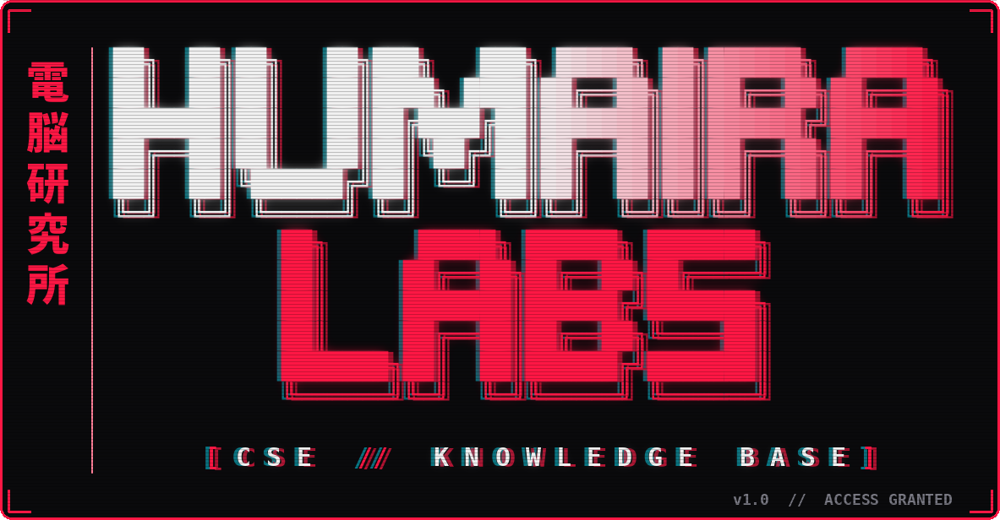
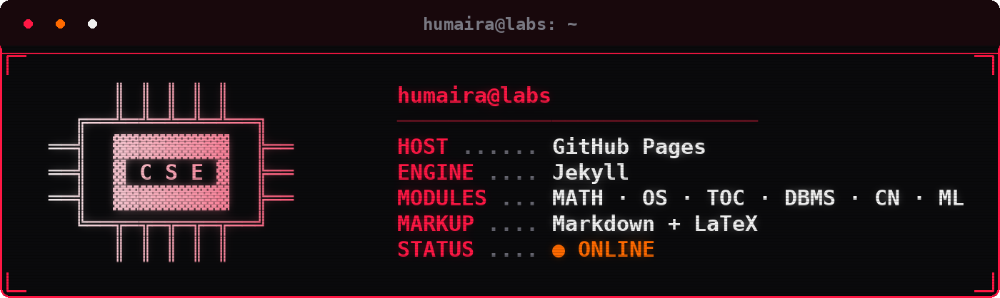
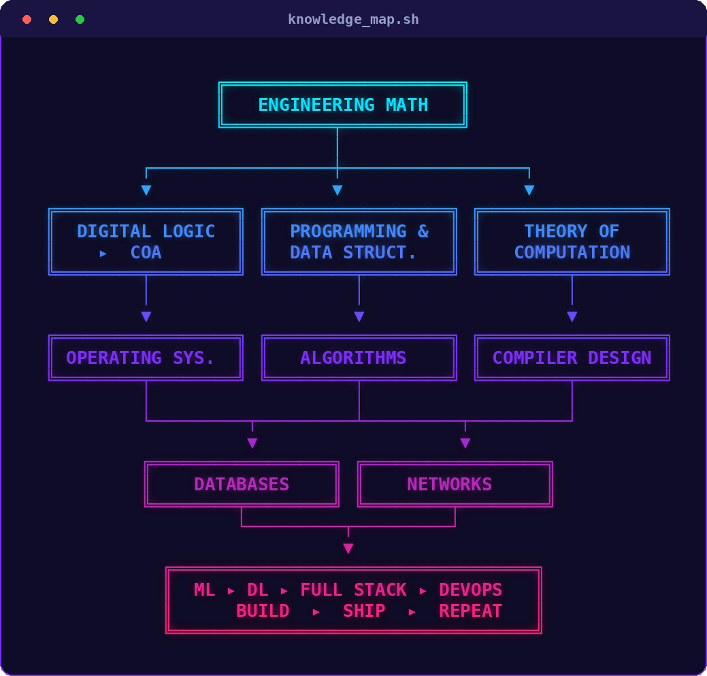

<div align="center">




<br>

[](https://humairat-codes.github.io)

[](https://humairat-codes.github.io)
[](https://jekyllrb.com/)
[](https://humairat-codes.github.io)
[](https://humairat-codes.github.io)

<br>

**[`01 CORE CS`](#01-core-cs)** · **[`02 APTITUDE`](#02-aptitude)** · **[`03 CODE ARENA`](#03-code-arena)** · **[`04 AI LAB`](#04-ai-lab)** · **[`05 DEV STACK`](#05-dev-stack)** · **[`06 TRANSMISSIONS`](#06-transmissions)**

</div>


## `>_ SYSTEM_INFO`

<div align="center">



</div>

```bash
$ cat /etc/mission
Clean, fast, no-fluff CS notes.
Hard concepts broken down until they stick.
Written to learn faster. Shared so you can too.
```

> **Legend:** 🟢 `ONLINE` = notes live on the blog &nbsp;·&nbsp; 🟡 `LOADING` = coming soon


## `[01]` CORE CS

> The full CS syllabus, one module at a time.

| # | MODULE | PAYLOAD | STATUS |
| :-: | :--- | :--- | :---: |
| 01 | `MATH.core`<br>**Engineering Mathematics** | **Discrete Math:** propositional & first-order logic, sets, relations, functions, partial orders & lattices, monoids, groups, graphs (connectivity, matching, colouring), combinatorics (counting, recurrences, generating functions)<br>**Linear Algebra:** matrices, determinants, linear systems, eigenvalues & eigenvectors, LU decomposition<br>**Calculus:** limits, continuity, differentiability, maxima & minima, mean value theorem, integration<br>**Probability & Statistics:** random variables, uniform / normal / exponential / Poisson / binomial distributions, mean-median-mode, standard deviation, conditional probability, Bayes' theorem | 🟢 ONLINE |
| 02 | `LOGIC.gates`<br>**Digital Logic** | Boolean algebra & minimization (algebraic, Karnaugh map, tabular method), combinational & sequential circuit design, number representation & arithmetic (fixed & floating point) | 🟡 LOADING |
| 03 | `COA.arch`<br>**Computer Organization & Architecture** | Instruction set & addressing modes, ALU design, control unit (hardwired & microprogrammed), memory interfacing & hierarchy, cache mapping, I/O interface (interrupt & DMA), instruction pipelining & hazards | 🟡 LOADING |
| 04 | `PDS.core`<br>**Programming & Data Structures** | Programming in C, recursion, arrays, stacks, queues, linked lists, trees, binary search trees, binary heaps, graphs | 🟡 LOADING |
| 05 | `ALGO.engine`<br>**Algorithms** | Searching, sorting, hashing, asymptotic time & space complexity, greedy, dynamic programming, divide & conquer, graph traversals, minimum spanning trees, shortest paths | 🟡 LOADING |
| 06 | `TOC.engine`<br>**Theory of Computation** | Regular expressions & finite automata, context-free grammars & pushdown automata, regular & context-free languages, pumping lemma, Turing machines & undecidability | 🟢 ONLINE |
| 07 | `COMPILER.forge`<br>**Compiler Design** | Lexical analysis, parsing, syntax-directed translation, runtime environments, intermediate code generation, local optimisation, data-flow analyses (constant propagation, liveness, common sub-expression elimination) | 🟡 LOADING |
| 08 | `OS.kernel`<br>**Operating Systems** | System calls, processes, threads, IPC, concurrency & synchronization, deadlock, CPU & I/O scheduling, memory management & virtual memory, file systems | 🟢 ONLINE |
| 09 | `DBMS.vault`<br>**Databases** | ER model, relational model (relational algebra, tuple calculus, SQL), integrity constraints, normal forms, file organization, indexing (B & B+ trees), transactions & concurrency control | 🟡 LOADING |
| 10 | `NET.grid`<br>**Computer Networks** | Layering, switching (circuit, packet, virtual circuit) & performance metrics, data link layer (error detection, MAC, Ethernet), distance-vector & link-state routing, IPv4 (fragmentation, CIDR, NAT), TCP flow & congestion control, socket API, DNS & HTTP | 🟢 ONLINE |


## `[02]` APTITUDE

> General Aptitude: the scoring module.

| MODULE | PAYLOAD | STATUS |
| :--- | :--- | :---: |
| `VERBAL.lang`<br>**Verbal Aptitude** | Basic English grammar (tenses, articles, adjectives, prepositions, conjunctions, verb-noun agreement), vocabulary (words, idioms, phrases in context), reading comprehension, narrative sequencing | 🟡 LOADING |
| `QUANT.calc`<br>**Quantitative Aptitude** | Data interpretation (bar graphs, pie charts, 2D & 3D plots, maps, tables), ratios, percentages, powers, exponents & logarithms, permutations & combinations, series, mensuration & geometry, elementary statistics & probability | 🟡 LOADING |
| `LOGIC.mind`<br>**Analytical Aptitude** | Deduction & induction, analogy, numerical relations & reasoning | 🟡 LOADING |
| `SPATIAL.vis`<br>**Spatial Aptitude** | Transformation of shapes (translation, rotation, scaling, mirroring, assembling, grouping), paper folding, cutting, patterns in 2D & 3D | 🟡 LOADING |


## `[03]` CODE ARENA

> Theory is nothing without code. This is where the notes get tested.

| TRACK | FOCUS | STATUS |
| :--- | :--- | :---: |
| `C` | Pointers, memory, recursion, data structures from scratch | 🟡 LOADING |
| `C++` | STL, OOP, fast implementations for contests | 🟡 LOADING |
| `JAVA` | OOP, collections framework, clean problem-solving | 🟡 LOADING |
| `LEETCODE` | Pattern-based problem solving, DSA practice | 🟡 LOADING |
| `CODEFORCES` | Contest rounds, editorials, speed & problem rating climb | 🟡 LOADING |

<div align="center">

[](https://humairat-codes.github.io)
[](https://humairat-codes.github.io)
[](https://humairat-codes.github.io)
[](https://leetcode.com)
[](https://codeforces.com)

</div>


## `[04]` AI LAB

| MODULE | PAYLOAD | STATUS |
| :--- | :--- | :---: |
| `ML.core`<br>**Machine Learning** | Regression, classification, clustering, model evaluation, feature engineering | 🟡 LOADING |
| `DL.neural`<br>**Deep Learning** | Neural networks, backpropagation, CNNs, RNNs, transformers | 🟡 LOADING |


## `[05]` DEV STACK

| LAYER | PAYLOAD | STATUS |
| :--- | :--- | :---: |
| `FRONTEND` | HTML, CSS, JavaScript, React | 🟡 LOADING |
| `BACKEND` | Node.js, Express, REST APIs, authentication | 🟡 LOADING |
| `DATA` | SQL, MongoDB, schema design | 🟡 LOADING |
| `DEVOPS` | Linux, Git, Docker, CI/CD, Kubernetes, cloud, monitoring | 🟡 LOADING |


## `[06]` TRANSMISSIONS

```diff
+ [NEW] Intro to Theory of Computation
  └─ Alphabet, Symbols, Strings, and Kleene Closures

+ [NEW] Process States in OS
  └─ Preemptive vs. Non-Preemptive scheduling

+ [NEW] Probability Basics
  └─ Axioms & Inclusion-Exclusion Principle, with PYQs
```

**▸ [Access all transmissions on the live blog →](https://humairat-codes.github.io)**

### Knowledge map

<div align="center">



</div>


<!-- AUTHOR SECTION HIDDEN: when you have your pfp link + assets/ascii-me.png, delete this line and the closing arrow line below
## `[07]` AUTHOR

<div align="center">


<br><br>

<details>
<summary><b>[ ▼ DECRYPT: ASCII_AUTHOR.png ]</b></summary>

<br>


</details>

</div>
-->


<div align="center">

### `BUILT WITH`


<br>

```
> "Good things take time."
> session closed. see you in the next post.
```


</div>
